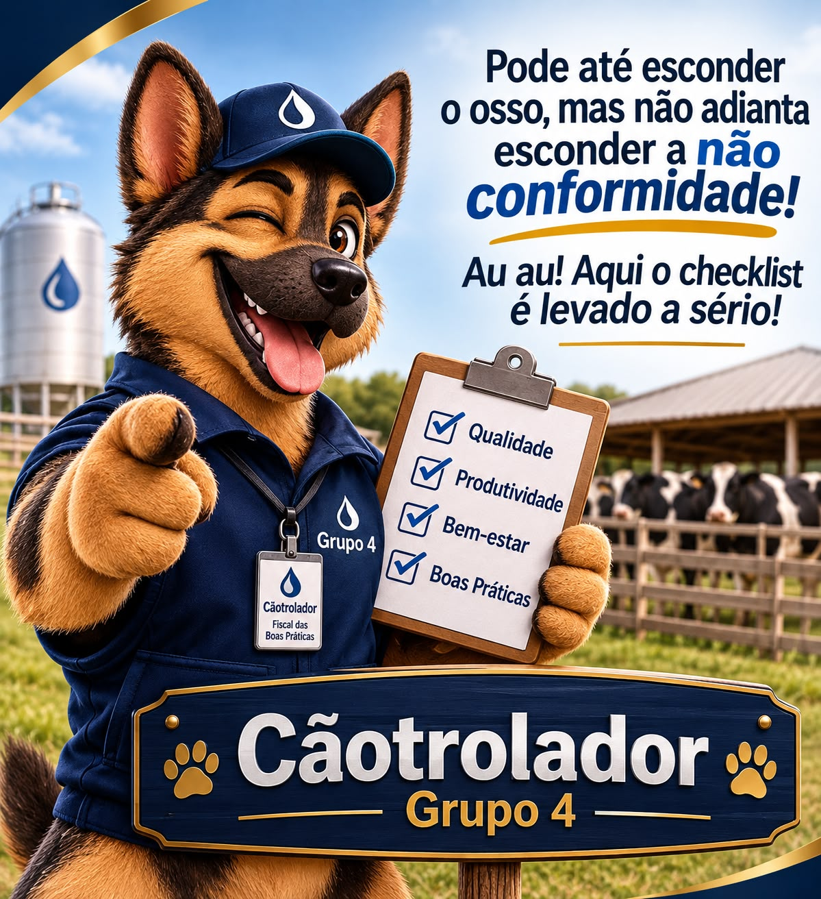

# Grupo 4 — Checklist de Boas Práticas

## Mascote: Cãotrolador

**Descrição:** O Cãotrolador é o mascote do Grupo 4. Um cão pastor responsável por fiscalizar as boas práticas, identificar não conformidades e lembrar que qualidade não é brincadeira!

# Etapa P — Planejar (PDCA)

## 1. Identificação do problema

Atualmente, a cooperativa utiliza checklists em papel para avaliar as boas práticas dos produtores de leite. Após a avaliação, os dados são digitados em planilhas, podendo levar aproximadamente uma semana para serem atualizados.

Esse processo apresenta alguns problemas, como perda de documentos, demora na divulgação dos resultados e dificuldade para acompanhar o histórico dos produtores.

Além disso, muitos produtores só descobrem que foram reprovados ou perderam parte da bonificação quando recebem o pagamento.

Diante disso, o grupo propõe um sistema digital de checklist que permita registrar as avaliações, calcular os resultados e apresentar orientações para corrigir as não conformidades.

## 2. Análise de Ishikawa

O diagrama apresenta as possíveis causas do problema identificado na cooperativa.

**Observação:** as causas apresentadas são hipóteses iniciais do grupo e precisam ser validadas com a cooperativa.

## 3. Análise SWOT

| FORÇAS (Strengths) | FRAQUEZAS (Weaknesses) |
|---|---|
| A cooperativa já possui um checklist com 35 requisitos. | Utilização de formulários em papel. |
| Os requisitos estão divididos em quatro pilares. | Demora na transferência dos dados para planilhas. |
| Existem critérios de pontuação e classificação. | Risco de perda de documentos. |
| Os técnicos conhecem o processo de avaliação. | Dificuldade para consultar o histórico. |

| OPORTUNIDADES (Opportunities) | AMEAÇAS (Threats) |
|---|---|
| Digitalizar o processo de avaliação. | Falta de internet em algumas propriedades. |
| Automatizar cálculos e classificações. | Resistência dos usuários à mudança. |
| Oferecer orientações para corrigir falhas. | Informações preenchidas incorretamente. |
| Criar indicadores para ajudar a gestão. | Riscos relacionados à segurança e privacidade dos dados. |

## 4. Requisitos funcionais — O que o sistema deve fazer?

1. Cadastrar produtores, com nome, propriedade, cidade e estado.
2. Cadastrar os técnicos responsáveis pelas avaliações.
3. Exibir os 35 requisitos divididos nos quatro pilares.
4. Permitir que o técnico registre cada requisito como conforme ou não conforme.
5. Identificar os requisitos obrigatórios que não foram atendidos.
6. Calcular automaticamente a pontuação dos requisitos pontuáveis.
7. Classificar o produtor como Ouro, Padrão ou Reprovado, conforme as regras da cooperativa.
8. Informar imediatamente quando um produtor for reprovado.
9. Mostrar quais requisitos não foram atendidos.
10. Disponibilizar orientações para corrigir as não conformidades.
11. Permitir consultar o histórico de avaliações dos produtores.
12. Gerar relatórios com os resultados das avaliações.
13. Apresentar indicadores sobre aprovações, reprovações e falhas frequentes.
14. Consultar a bonificação correspondente à classificação do produtor.
15. Identificar avaliações incompletas ou pendentes.

## 5. Requisitos não funcionais

- **Facilidade de uso:** o sistema deve ter uma interface simples e intuitiva.
- **Segurança:** os dados devem ser protegidos contra acessos não autorizados.
- **Privacidade:** as informações dos produtores devem ser utilizadas de forma adequada, respeitando a LGPD.
- **Confiabilidade:** os cálculos e resultados devem ser apresentados corretamente.
- **Integridade:** os registros não devem ser perdidos ou alterados indevidamente.
- **Rastreabilidade:** deve ser possível identificar quem realizou cada avaliação e quando ela aconteceu.

## 6. Regras de negócio a confirmar com a cooperativa

- A reprovação acontece quando qualquer requisito obrigatório não é atendido?
- Qual é a pontuação mínima para as classificações Ouro e Padrão?
- Quais são os valores de bonificação por litro para cada classificação?
- Os pontos são concedidos quando os requisitos pontuáveis são atendidos?

Essas regras precisam ser confirmadas com a cooperativa para garantir que o sistema apresente resultados corretos.
